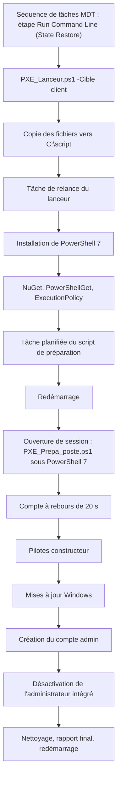
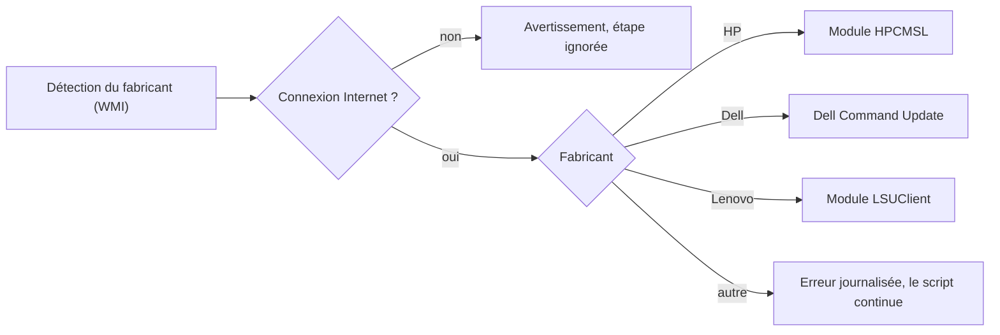
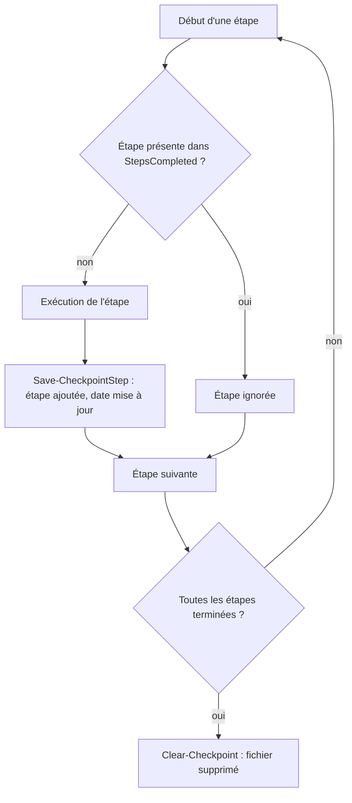

# Windows-Auto-Install

Préparation automatique d'un poste Windows après son déploiement PXE (MDT/WDS), pour un contexte MSP : pilotes et firmwares constructeur, mises à jour Windows, création d'un compte administrateur local dont le mot de passe dépend du client, désactivation du compte administrateur intégré.

Le projet est écrit en PowerShell et repose sur deux scripts qui se relaient autour d'un redémarrage, avec un système de reprise (checkpoint) en cas d'interruption.

## Sommaire

1. [Contenu du dépôt](#contenu-du-dépôt)
2. [Prérequis](#prérequis)
3. [Utilisation](#utilisation)
4. [Vue d'ensemble](#vue-densemble)
5. [Fonctionnement détaillé](#fonctionnement-détaillé)
6. [Gestion des pilotes par fabricant](#gestion-des-pilotes-par-fabricant)
7. [Reprise après interruption](#reprise-après-interruption)
8. [Fichier config.json](#fichier-configjson)
9. [Journalisation](#journalisation)
10. [Sécurité](#sécurité)

## Contenu du dépôt

| Fichier | Rôle |
|---|---|
| `PXE_Lanceur.ps1` | Prépare l'environnement : copie les fichiers, installe PowerShell 7 et les dépendances, crée les tâches planifiées, puis redémarre le poste. |
| `PXE_Prepa_poste.ps1` | Script principal, exécuté après le redémarrage : pilotes, mises à jour Windows, comptes locaux, nettoyage, rapport. |
| `config.json` | Mots de passe du compte `admin`, un par client (clé = valeur du paramètre `-Cible`). |

## Prérequis

- Windows 10 ou 11 (64 bits), session ouverte avec un compte disposant des droits administrateur.
- Accès Internet (téléchargement de PowerShell 7, des modules PowerShell et des mises à jour).
- `config.json` présent à côté des scripts, avec la structure décrite plus bas.
- Fabricants pris en charge pour les pilotes : HP, Dell, Lenovo.

## Utilisation

### Intégration dans MDT

Le lanceur est appelé par la séquence de tâches MDT, sous forme d'une étape **Run Command Line** placée à la fin du groupe **State Restore** (après l'étape Imaging). Les trois fichiers sont déposés dans le sous-dossier `perso` des scripts du deployment share.

| Champ de l'étape | Valeur |
|---|---|
| Type | Run Command Line |
| Command line | `powershell.exe -ExecutionPolicy Bypass -File "%ScriptRoot%\PXE_Lanceur.ps1" -Cible <nom_du_client>` |
| Start in | `%ScriptRoot%\` |

Il faut une séquence de tâches par client (par exemple « Installation de Win 11 automatique commun »), chacune passant sa propre valeur à `-Cible`. Les étapes MDT « Windows Update » peuvent rester désactivées : les mises à jour sont gérées par `PXE_Prepa_poste.ps1`.

### Lancement manuel

Le lanceur peut aussi être exécuté à la main, en copiant le projet sur un poste, depuis le dossier qui contient les trois fichiers :

```powershell
.\PXE_Lanceur.ps1 -Cible <nom_du_client>
```

`<nom_du_client>` correspond à une clé de `config.json`. Le reste du processus est automatique : le poste redémarre, et le script de préparation se lance à l'ouverture de session suivante après un compte à rebours de 20 secondes.

## Vue d'ensemble



## Fonctionnement détaillé

### Phase 1 : `PXE_Lanceur.ps1`

Le lanceur tourne sous Windows PowerShell 5.1 et prépare tout ce dont le script principal a besoin.

0. **Anti-veille.** Appel de l'API Windows `SetThreadExecutionState` (via un type C# chargé avec `Add-Type`) pour empêcher la mise en veille du système et de l'écran pendant les longues opérations. Le comportement normal est restauré avant le redémarrage.
1. **Copie des fichiers.** `PXE_Prepa_poste.ps1`, `PXE_Lanceur.ps1` et `config.json` sont copiés dans `C:\script\`, pour rester disponibles après le redémarrage. Le script s'arrête si `PXE_Prepa_poste.ps1` est introuvable.
2. **Tâche de relance du lanceur.** Création de la tâche `ExecuteLauncherAgain` (déclencheur : ouverture de session, droits maximum, autorisée sur batterie). Elle relance le lanceur si le poste redémarre avant la fin de cette phase.
3. **Installation de PowerShell 7.** Si `pwsh.exe` est absent, installation via `winget` ; en cas d'échec, repli sur le téléchargement du MSI officiel depuis GitHub, installé en silencieux. Le script s'arrête si PowerShell 7 reste introuvable après installation.
4. **Dépendances PowerShell.** Installation du fournisseur NuGet et du module PowerShellGet (portée tous utilisateurs), puis politique d'exécution `RemoteSigned` au niveau machine.
5. **Tâche du script de préparation.** Création de la tâche `ExecutePXEScriptOnce` (ouverture de session, droits maximum) qui lance `PXE_Prepa_poste.ps1` avec PowerShell 7 et le même paramètre `-Cible`.
6. **Fin et redémarrage.** Suppression du checkpoint, suppression de la tâche `ExecuteLauncherAgain`, restauration de la mise en veille, puis `shutdown /r /t 10`.

### Phase 2 : `PXE_Prepa_poste.ps1`

Exécuté sous PowerShell 7 à l'ouverture de session suivante.

1. **Anti-veille**, comme dans le lanceur.
2. **Contrôle des droits.** Le script s'arrête avec un message d'erreur s'il n'est pas lancé en administrateur.
3. **Récupération du mot de passe.** Lecture de `C:\script\config.json`, sélection de la clé correspondant à `-Cible`, remplacement de `{year}` par l'année en cours. Si le fichier n'est pas lisible, le mot de passe par défaut `admin` est utilisé.
4. **Compte à rebours de 20 secondes.** Affichage du fabricant détecté, du mot de passe du compte qui va être créé et de la liste des actions prévues, ce qui laisse le temps d'interrompre le script.
5. **Informations système.** Nom du PC, fabricant, modèle, OS, architecture, RAM et CPU sont écrits dans le journal.
6. **Pilotes, BIOS et firmwares constructeur.** Détection du fabricant via WMI (`Win32_ComputerSystem`), puis installation avec l'outil adapté (voir la section suivante). Cette étape est ignorée avec un avertissement si le poste n'a pas de connexion Internet (test par ping vers `8.8.8.8`).
7. **Mises à jour Windows.** Installation du module `PSWindowsUpdate` si besoin, puis `Install-WindowsUpdate` avec les mises à jour Microsoft, sans redémarrage automatique. Le nombre de mises à jour installées et la durée sont enregistrés.
8. **Création du compte `admin`.** Si le compte n'existe pas, création avec le mot de passe issu de `config.json` (sans expiration) et ajout au groupe Administrateurs par son SID `S-1-5-32-544`, ce qui fonctionne quelle que soit la langue de Windows.
9. **Désactivation de l'administrateur intégré.** Le compte est retrouvé par son RID `500` (SID se terminant par `-500`) et désactivé, également indépendamment de la langue.
10. **Nettoyage, rapport et redémarrage.** Suppression des scripts et de la tâche planifiée, génération du rapport final (heures de début et de fin, durée, nombre de mises à jour, pilotes installés ou non), restauration de la mise en veille, puis redémarrage.

## Gestion des pilotes par fabricant



| Fabricant | Outil | Fonctionnement |
|---|---|---|
| HP | module `HPCMSL` | Récupère la liste des SoftPaqs des catégories Driver, BIOS et Firmware pour le modèle, puis les installe un par un en silencieux. Un SoftPaq en échec est journalisé en avertissement et n'arrête pas la boucle. |
| Dell | Dell Command Update (`dcu-cli.exe`) | Installe l'outil via `winget` (avec le contournement temporaire du certificate pinning du Microsoft Store, désactivé ensuite), lance `/scan` puis `/applyUpdates -forceUpdate=enable`. |
| Lenovo | module `LSUClient` | Récupère les mises à jour compatibles avec une installation sans surveillance (`Installer.Unattended`), les télécharge puis les installe. |

Le fabricant est normalisé à partir de la valeur WMI brute (`hp|hewlett`, `dell`, `lenovo`). Tout autre fabricant est signalé en erreur sans interrompre le reste du script.

## Reprise après interruption

Chaque script sauvegarde sa progression dans un fichier JSON (checkpoint). Une étape déjà terminée n'est pas rejouée au lancement suivant.



- Le fichier contient `CurrentStep`, `StepsCompleted`, `StartTime`, `LastUpdate` et `Cible` (plus `Fabricant` pour le script principal).
- Un fichier corrompu est supprimé puis réinitialisé automatiquement.
- Au démarrage, une reprise est signalée à l'écran avec l'étape interrompue et la liste des étapes déjà faites.
- Le paramètre `Cible` est conservé dans le checkpoint pour être retrouvé après un redémarrage.

## Fichier config.json

Une clé par client, la valeur étant le mot de passe du compte `admin` créé sur ses postes. Le motif `{year}` est remplacé par l'année en cours.

```json
{
  "client_a": "<mot_de_passe_client_a>",
  "client_b": "<mot_de_passe_client_b>.{year}"
}
```

Le paramètre `-Cible` du lanceur sélectionne la clé à utiliser.

## Journalisation

Tous les messages sont affichés en couleur dans la console selon leur niveau (INFO, SUCCESS, WARNING, ERROR) et écrits horodatés dans `C:\Logs\`.

| Fichier | Contenu |
|---|---|
| `C:\Logs\LanceurPreparationPoste.log` | Journal du lanceur |
| `C:\Logs\ScriptPreparationPoste.log` | Journal du script de préparation, avec le rapport final |
| `C:\Logs\LanceurCheckpoint.json` | Checkpoint du lanceur |
| `C:\Logs\ScriptCheckpoint.json` | Checkpoint du script de préparation |

## Sécurité

- Les mots de passe sont stockés en clair dans `config.json`, copié dans `C:\script\` pendant l'exécution.
- Le mot de passe du compte `admin` est affiché à l'écran pendant le compte à rebours.
- Si `config.json` est illisible, le compte est créé avec le mot de passe par défaut `admin`.
- Le script exige des droits administrateur et force la politique d'exécution `RemoteSigned` sur la machine.
- Le compte administrateur intégré est désactivé en fin de préparation.
